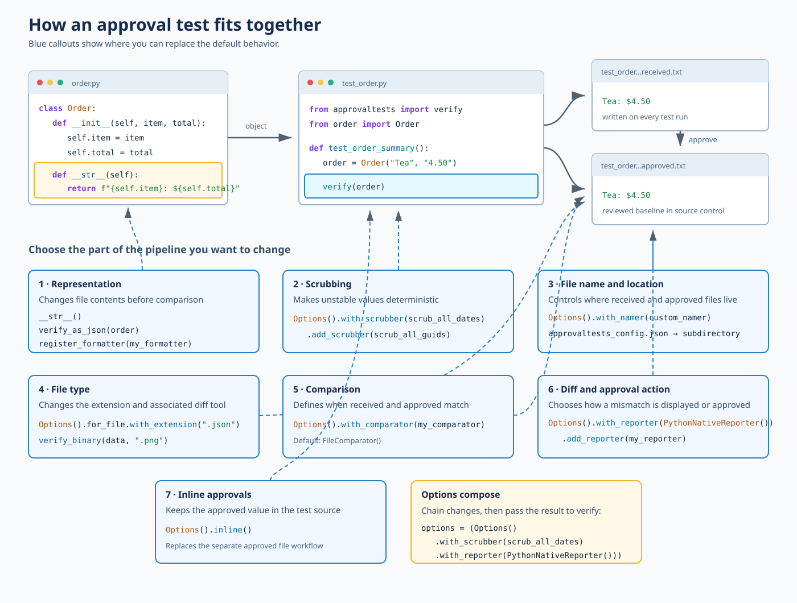

# Options

<!-- toc -->
## Contents

  * [Configuration for verify](#configuration-for-verify)
  * [Configuration map](#configuration-map)
  * [A complete example](#a-complete-example)
  * [What each option changes](#what-each-option-changes)
  * [Configuration recipes](#configuration-recipes)
  * [Inline Approvals](#inline-approvals)
    * [Known Issues](#known-issues)<!-- endToc -->

## Configuration for verify

All verify methods take an optional `options` parameter. This allows you to configure

- The reporter
- Scrubbers
- File names and extensions
- The comparator
- Inline approvals

Options are immutable: every configuration method returns a new `Options` value. You
can chain configuration methods and reuse the result.

## Configuration map

The following picture starts with a real object and shows how its representation
flows through `verify()` into the received and approved files. The blue callouts
identify each place where the default behavior can be changed.

Open the [interactive configuration explorer](configuration-options.html) to
select a configuration point, highlight the affected pipeline stages, and copy
its complete code example.

The SVG below is a static fallback for documentation viewers that do not run HTML.



## A complete example

Given an object whose `__str__()` method controls its text representation:

```python
class Order:
    def __init__(self, item: str, total: str):
        self.item = item
        self.total = total

    def __str__(self) -> str:
        return f"{self.item}: ${self.total}"
```

you can compose options and pass them to `verify()`:

```python
from approvaltests import Options, verify
from approvaltests.reporters import PythonNativeReporter
from approvaltests.scrubbers import scrub_all_dates


def test_order_summary():
    order = Order("Tea", "4.50")
    options = (
        Options()
        .with_scrubber(scrub_all_dates)
        .with_reporter(PythonNativeReporter())
        .for_file.with_extension(".txt")
    )

    verify(order, options=options)
```

The first run writes `test_order.test_order_summary.received.txt`. Once the output
has been reviewed, the reporter shows how to move or copy it to
`test_order.test_order_summary.approved.txt`. Later runs compare the two files.

## What each option changes

| If you want to change... | Use | Example |
|---|---|---|
| The text written to the received file | An object's `__str__()`, a specialized verify method, or a formatter | `verify_as_json(order)` |
| Unstable values in the output | `with_scrubber()` and `add_scrubber()` | `Options().with_scrubber(scrub_all_dates)` |
| The approved and received file names | `with_namer()` | `Options().with_namer(custom_namer)` |
| The directory containing approval files | `approvaltests_config.json` | `{"subdirectory": "approved_files"}` |
| The file extension | `for_file.with_extension()` | `Options().for_file.with_extension(".json")` |
| Whether two files are considered equal | `with_comparator()` | `Options().with_comparator(custom_comparator)` |
| How differences are shown or approved | `with_reporter()` and `add_reporter()` | `Options().with_reporter(PythonNativeReporter())` |
| Where the approved value is stored | `inline()` | `Options().inline()` |

`with_namer()` and `with_comparator()` accept implementations of the `Namer` and
`Comparator` interfaces respectively. Reporters included with ApprovalTests are
available from `approvaltests.reporters`.

## Configuration recipes

Every recipe includes the required import and can be used independently.

### Change the representation

Use a specialized verify method when the value has a standard representation:

```python
from approvaltests import verify_as_json

verify_as_json({"item": "Tea", "total": "4.50"})
```

For your own class, implementing `__str__()` is usually the smallest customization:

```python
class Order:
    def __str__(self) -> str:
        return f"{self.item}: ${self.total}"
```

### Scrub changing values

`with_scrubber()` sets the first scrubber; `add_scrubber()` composes another one
after it:

```python
from approvaltests import Options, verify
from approvaltests.scrubbers import scrub_all_dates, scrub_all_guids

options = (
    Options()
    .with_scrubber(scrub_all_dates)
    .add_scrubber(scrub_all_guids)
)
verify(result, options=options)
```

### Change the file name

Use a scenario name when one test verifies several inputs:

```python
from approvaltests import verify
from approvaltests.namer import NamerFactory

verify(result, options=NamerFactory.with_parameters("logged-in", "admin"))
```

For complete control, implement the `Namer` interface and pass an instance to
`Options().with_namer(...)`.

### Change the file location

Place `approvaltests_config.json` beside the test. No Python change is needed:

```json
{
  "subdirectory": "approved_files"
}
```

### Change the file extension

```python
from approvaltests import Options, verify

verify(markdown, options=Options().for_file.with_extension(".md"))
```

For bytes, use `verify_binary()` instead:

```python
from approvaltests import verify_binary

verify_binary(image_bytes, ".png")
```

### Change comparison behavior

Implement `Comparator.compare()` and provide the implementation through options:

```python
from approvaltests import Options, verify
from approvaltests.core.comparator import Comparator


class CaseInsensitiveComparator(Comparator):
    def compare(self, received_path: str, approved_path: str) -> bool:
        with open(received_path, encoding="utf-8") as received:
            received_text = received.read()
        with open(approved_path, encoding="utf-8") as approved:
            approved_text = approved.read()
        return received_text.casefold() == approved_text.casefold()


verify(result, options=Options().with_comparator(CaseInsensitiveComparator()))
```

### Change the diff or approval action

```python
from approvaltests import Options, verify
from approvaltests.reporters import PythonNativeReporter

verify(result, options=Options().with_reporter(PythonNativeReporter()))
```

To run an additional reporter after the configured reporter:

```python
from approvaltests import Options
from approvaltests.reporters import PythonNativeReporter, ReportWithBeyondCompare

options = (
    Options()
    .with_reporter(PythonNativeReporter())
    .add_reporter(ReportWithBeyondCompare())
)
```

### Keep the approval inline

```python
from approvaltests import Options, verify

verify(result, options=Options().inline())
```

## Inline Approvals

### Known Issues

- Pycharm automatically removes trailing whitespace, which can cause the approval file to be different from the actual output.
  - To disable this behavior go to:
  - File -> Settings -> Editor -> General -> On Save -> [ ] Remove trailing spaces
